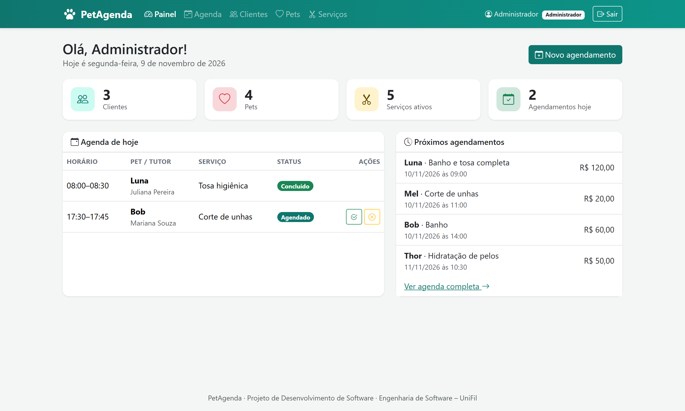
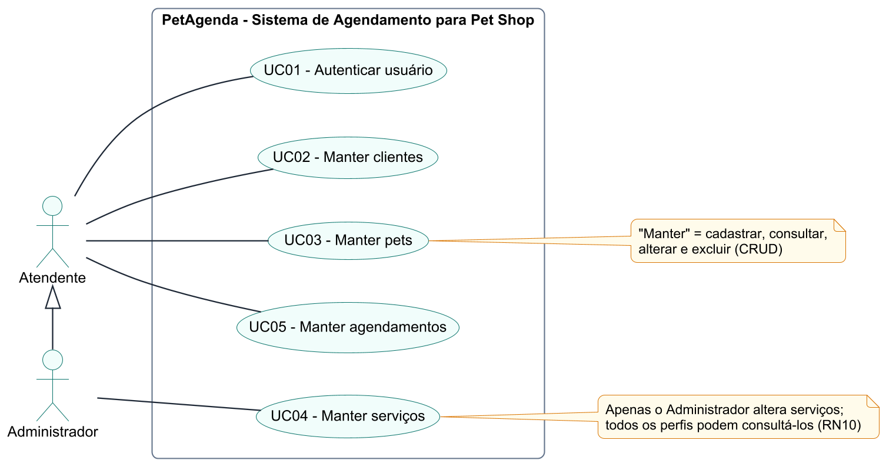
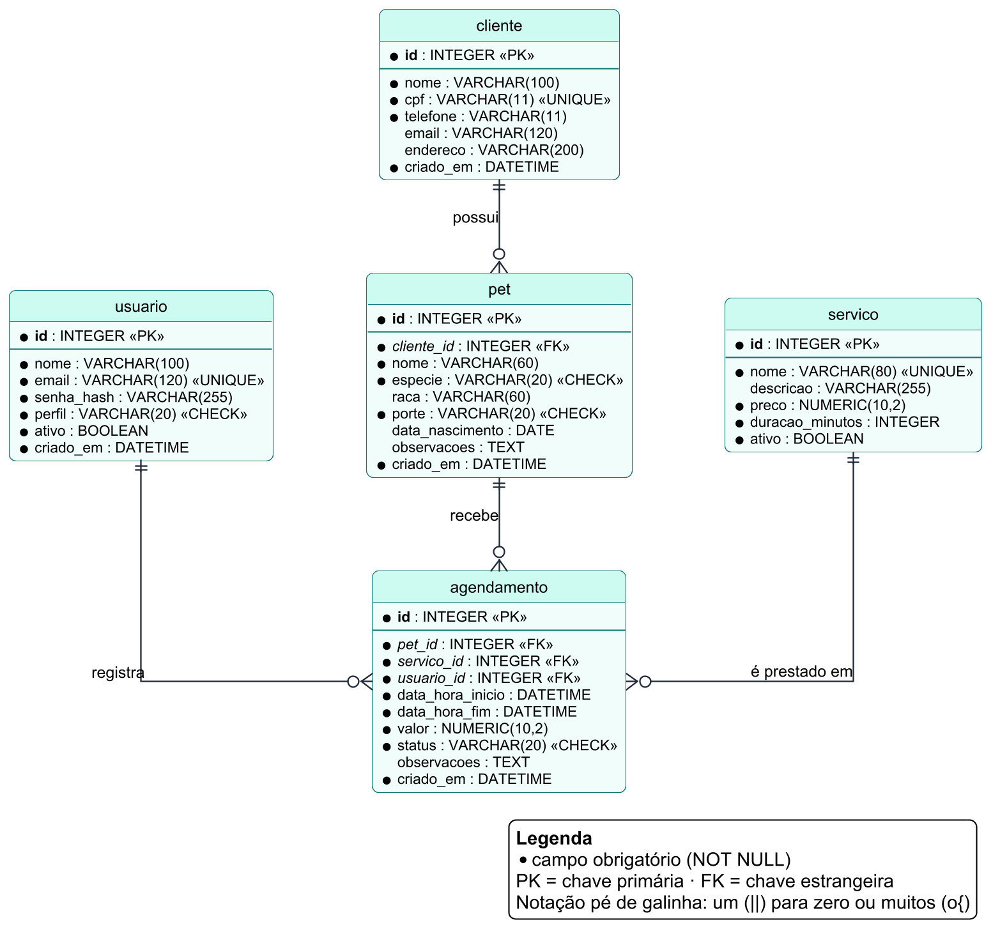

# 🐾 PetAgenda

Sistema web de **agendamento de banho e tosa para pet shops**, desenvolvido nas disciplinas de
**Projeto de Desenvolvimento de Software I e II** do curso de **Engenharia de Software – UniFil**.

| | |
|---|---|
| **Autor** | Lucas Leonardo Sambati — **projeto individual** |
| **Curso** | Engenharia de Software · Centro Universitário Filadélfia (UniFil) · Londrina, 2026 |
| **Documentação (PDS I)** | [`docs/PetAgenda_Documentacao.pdf`](docs/PetAgenda_Documentacao.pdf) |
| **Versão entregue (PDS II)** | tag `v1.0.0` |



## Funcionalidades

O sistema implementa os **5 casos de uso** da documentação, com **CRUD completo** e persistência em banco de dados:

| Caso de uso | O que faz | Código |
|---|---|---|
| UC01 – Autenticar usuário | Login com e-mail e senha (hash) e logout | `app/routes/auth.py` |
| UC02 – Manter clientes | Cadastrar, consultar (busca por nome/CPF/telefone), alterar e excluir tutores | `app/routes/clientes.py` |
| UC03 – Manter pets | CRUD de pets vinculados a um cliente, com idade calculada | `app/routes/pets.py` |
| UC04 – Manter serviços | CRUD de serviços (preço, duração, ativo) — apenas Administrador | `app/routes/servicos.py` |
| UC05 – Manter agendamentos | Agendar, consultar agenda (filtros), remarcar, concluir, cancelar e excluir + painel do dia | `app/routes/agendamentos.py`, `app/routes/main.py` |

### Regras de negócio implementadas

- **RN01** CPF válido (dígitos verificadores) e único
- **RN02** Todo pet pertence a um cliente
- **RN03** Não agenda em data/horário passado
- **RN04** Sem conflito de horário entre agendamentos ativos
- **RN05** Funcionamento de segunda a sábado, das 08h às 18h
- **RN06** Término calculado pela duração do serviço e valor gravado no momento do agendamento
- **RN07** Ciclo de vida: Agendado → Concluído ou Cancelado (concluídos/cancelados não mudam)
- **RN08** Não exclui cliente com pets nem pet com agendamentos
- **RN09** Serviço inativo não recebe agendamentos; serviço já usado só pode ser inativado
- **RN10** Somente o Administrador altera serviços

## Tecnologias

Python 3.13 · Flask 3.1 · Flask-SQLAlchemy / SQLAlchemy 2.1 (ORM) · **SQLite** · Jinja2 · Bootstrap 5 · pytest · PlantUML (diagramas)

Arquitetura **MVC**: `models.py` (Model) · `templates/` (View) · `routes/` com um *blueprint* por caso de uso (Controller).

## Como executar

Pré-requisito: **Python 3.11 ou superior**.

```bash
git clone https://github.com/Lucas-Sambati/petagenda.git
cd petagenda
python -m venv .venv
.venv\Scripts\activate          # Windows  (Linux/macOS: source .venv/bin/activate)
pip install -r requirements.txt
python run.py
```

Acesse **http://127.0.0.1:5000**. Na primeira execução o banco `instance/petagenda.db` é criado com dados de exemplo.

| Perfil | E-mail | Senha |
|---|---|---|
| Administrador | `admin@petagenda.com` | `admin123` |
| Atendente | `atendente@petagenda.com` | `atendente123` |

Comandos úteis:

```bash
flask --app run reset-db        # recria o banco com os dados de exemplo
flask --app run banco           # mostra o conteúdo do banco usando consultas SQL
flask --app run criar-usuario   # cria um novo usuário
python -m pytest -v             # executa os 40 testes automatizados
```

## Estrutura do projeto

```
petagenda/
├── app/
│   ├── __init__.py        # create_app: configuração, banco, blueprints e comandos
│   ├── models.py          # entidades (Usuario, Cliente, Pet, Servico, Agendamento)
│   ├── validacoes.py      # validações e regras de negócio (RN01 a RN10)
│   ├── seguranca.py       # login, perfis de acesso e proteção CSRF
│   ├── seed.py            # dados de exemplo
│   ├── routes/            # controllers: um blueprint por caso de uso
│   ├── templates/         # telas (Jinja2 + Bootstrap)
│   └── static/            # CSS, JS e Bootstrap (local, funciona offline)
├── docs/
│   ├── PetAgenda_Documentacao.pdf   # documentação completa (PDS I)
│   ├── diagramas/                   # fontes PlantUML (.puml) e imagens (png/)
│   ├── banco/schema.sql             # script do banco (modelo físico)
│   └── telas/                       # capturas de tela
├── tests/                 # testes automatizados (pytest)
├── config.py
├── requirements.txt
└── run.py
```

## Documentação e diagramas

A documentação em PDF contém requisitos funcionais e não funcionais, regras de negócio, especificação dos casos de uso,
diagrama de casos de uso, DER, diagrama de atividade, diagrama de classes e um diagrama de sequência para cada caso de uso.
As fontes dos diagramas estão em [`docs/diagramas`](docs/diagramas) e podem ser regeneradas com o [PlantUML](https://plantuml.com/).

| Casos de uso | DER |
|---|---|
|  |  |

## Testes

```bash
python -m pytest -v
```

40 testes cobrem autenticação, o CRUD de cada entidade e todas as regras de negócio, usando um banco SQLite em memória.

---

Projeto acadêmico — UniFil, 2026.
